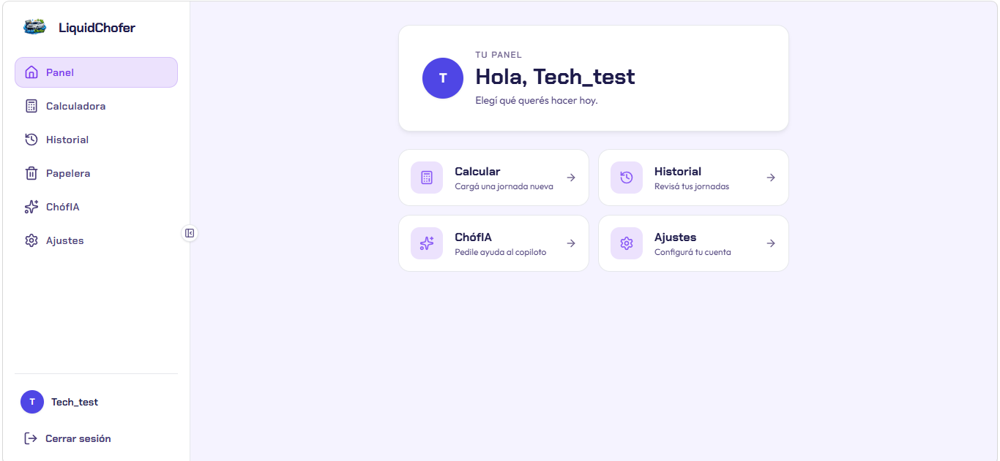
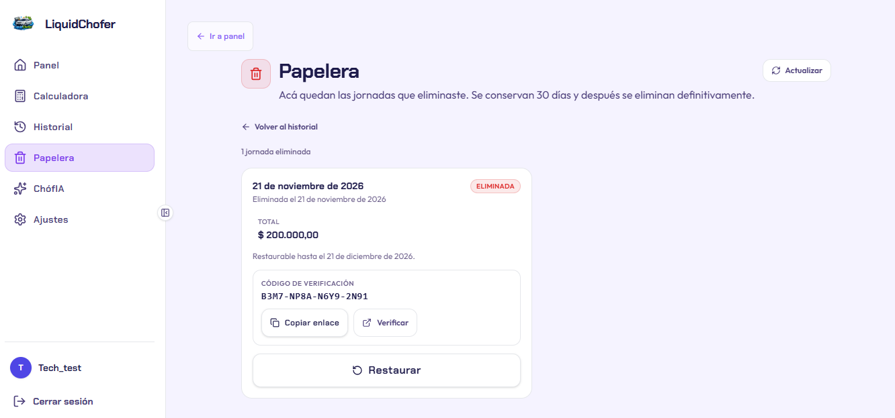
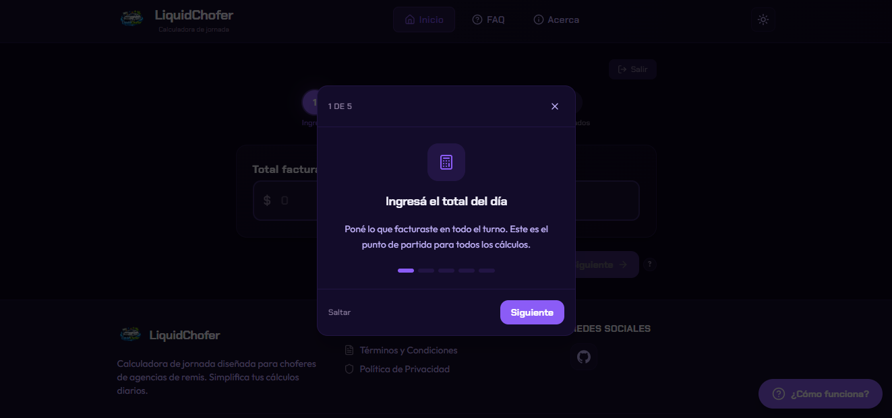

# LiquidChofer v2.0.0

Calculadora de jornada para choferes de agencias de remis. Permite cerrar el turno con menos pasos manuales: total del día, vales, porcentajes, gastos, resultado final, historial y comprobante.

> **Estado:** aplicación web instalable (PWA) con frontend React + Vite y un backend NestJS separado que valida, calcula y persiste las jornadas.

## Tabla de Contenidos

- [Objetivo](#objetivo)
- [Funcionalidades](#funcionalidades)
- [Stack Tecnológico](#stack-tecnológico)
- [Arquitectura](#arquitectura)
- [Requisitos](#requisitos)
- [Instalación](#instalación)
- [Variables de Entorno](#variables-de-entorno)
- [Uso Local](#uso-local)
- [Flujo de Cálculo](#flujo-de-cálculo)
- [Historial de Jornadas](#historial-de-jornadas)
- [ChófIA](#chófia)
- [Ajustes y Cuenta](#ajustes-y-cuenta)
- [Rutas](#rutas)
- [API Consumida](#api-consumida)
- [Estructura del Proyecto](#estructura-del-proyecto)
- [Capturas de Pantalla](#capturas-de-pantalla)
- [Despliegue en Vercel](#despliegue-en-vercel)
- [Documentación Relacionada](#documentación-relacionada)
- [Licencia](#licencia)

## Objetivo

`LiquidChofer` resuelve el cierre diario de un chofer cuando debe combinar importes de una app externa, gastos de combustible, porcentajes de reparto y viajes con vale.

La app permite:

- Ingresar el total facturado del día.
- Cargar gastos de gas y nafta.
- Configurar porcentajes de agencia, conductor y vehículo alquilado.
- Indicar quién es el dueño del auto cuando **no** está alquilado.
- Registrar vales de tipo `Fábrica` u `Otro`.
- Bloquear el cálculo si hay vales incompletos o porcentajes que no suman 100%.
- Mostrar resultados solo después de presionar **Calcular resultados**.
- Guardar la jornada en el historial y generar un comprobante en PDF o imagen.
- Consultar jornadas anteriores, ver su detalle y eliminarlas.
- Usar **ChófIA**, un asistente que responde dudas sobre la app y ayuda a armar el cálculo a partir de texto o imágenes.

## Funcionalidades

### Calculadora

- Wizard de 5 pasos: ingreso, vales, porcentajes, gastos y resultados.
- Botón **Calcular resultados** obligatorio antes de mostrar el desglose.
- Cualquier cambio confirmado en datos relevantes invalida el cálculo anterior.
- Reducer central para el estado de la calculadora.
- Validación de porcentajes: deben sumar exactamente 100%.
- Vales guardables: solo los vales guardados entran en el cálculo y habilitan el avance.
- Edición controlada de vales: **Actualizar** se habilita solo si hay cambios reales.
- Limpieza de borradores: al volver atrás desde vales se descartan vales no guardados y ediciones pendientes.
- Toggle de vales bloqueado cuando existen vales guardados.
- Scroll automático al agregar un nuevo vale.
- Botón **Reiniciar** con modal de confirmación.

### Historial

- Guardado de la jornada con fecha (por defecto, hoy).
- Listado paginado de 20 jornadas, con opción de cargar más.
- Detalle de cada jornada con sus vales.
- Descarga en PDF y envío por WhatsApp desde el detalle.
- Eliminación con confirmación.
- La jornada guardada **no se puede editar**: si necesitás corregirla, guardá una nueva.

### ChófIA

- Responde dudas sobre el uso de la app, además de ayudar con el cálculo.
- Chat con texto e imágenes.
- Hasta 3 imágenes por mensaje en JPG, PNG o WEBP (máximo 8 MB cada una).
- Las imágenes se reducen y recodifican a JPEG de 1280 px antes de enviarse.
- Texto de hasta 2000 caracteres por mensaje.
- Cuota diaria de uso, con indicador de mensajes restantes.
- Lista de conversaciones, historial de mensajes y eliminación de conversaciones.
- Cuando ChófIA detecta datos suficientes, muestra una tarjeta de cálculo.
- El cálculo se incorpora a la calculadora recién cuando el usuario lo confirma.

### Cuenta y ajustes

- Registro e inicio de sesión con correo/contraseña o Google.
- Verificación de correo y reenvío del enlace.
- Recuperación de contraseña.
- Vinculación de Google con una cuenta de correo existente.
- Edición del nombre visible.
- Cambio de correo y de contraseña (solo cuentas con contraseña).
- Eliminación de cuenta con confirmación.
- Porcentajes por defecto, dueño del auto por defecto y preferencia de tema.
- Tema claro/oscuro persistido en el dispositivo.
- Onboarding de primer uso y botón de ayuda flotante.

### Experiencia de uso

- PWA instalable con actualización automática.
- Pantalla de mantenimiento configurable.
- Banners de patrocinio configurables por variables de entorno.
- Metadatos Open Graph y Twitter Cards.
- `sitemap.xml` y `robots.txt` generados a partir de `VITE_DOMAIN`.
- Error boundary con acción de recarga.

## Stack Tecnológico

Versiones instaladas al momento de esta actualización:

| Tecnología | Versión | Uso |
| --- | --- | --- |
| React | 19.3.1 | UI |
| React DOM | 19.3.1 | Render |
| TypeScript | 6.0.3 | Tipado |
| Vite | 8.3.7 | Build y dev server |
| Tailwind CSS | 4.3.5 | Estilos |
| React Router | 7.18.5 | Rutas SPA |
| Zod | 4.6.7 | Validación |
| Firebase | 12.18.0 | Autenticación (solo Auth) |
| lucide-react | 1.71.0 | Íconos |
| react-markdown + remark-gfm | 10.1.0 / 4.0.1 | Render de mensajes de ChófIA |
| html-to-image | 1.11.13 | Exportar el comprobante como imagen |
| jsPDF | 4.2.1 | Exportar el comprobante como PDF |
| vite-plugin-pwa | 1.3.0 | PWA y service worker |

## Arquitectura

- **Frontend:** React + Vite + TypeScript + Tailwind. Este repositorio.
- **Backend:** servicio NestJS separado que expone `/api/v1/*`. No está incluido en este repositorio.
- **Autenticación:** Firebase Auth se usa únicamente para identificar al usuario (correo/contraseña o Google). La sesión real de la aplicación la mantiene el backend mediante una cookie `http-only`; el frontend intercambia el token de Firebase por esa sesión.
- **Persistencia:** las jornadas, el borrador, los ajustes y las conversaciones de ChófIA se guardan en la base de datos del backend. **No se usa Firestore ni almacenamiento de Firebase.**
- **Cálculo definitivo:** al guardar una jornada, el backend valida, recalcula y persiste los importes. La vista previa del frontend es estimativa.

## Requisitos

- Node.js 24.x (verificado con `v24.22.1`).
- pnpm 12.x (verificado con `12.18.0`).
- Backend NestJS accesible desde `VITE_API_URL`.

## Instalación

```bash
pnpm install
```

## Variables de Entorno

Copiá `.env.example` a `.env` y completá los valores. **No subas `.env` al repositorio.**

| Variable | Requerida | Descripción | Ejemplo |
| --- | --- | --- | --- |
| `VITE_GITHUB` | No | URL del repositorio para el enlace del footer | `URL_DE_REPOSITORIO` |
| `VITE_DOMAIN` | Producción | Dominio público (SEO: canonical, sitemap y robots.txt) | `TU_DOMINIO` |
| `VITE_MAINTENANCE_MODE` | No | Activa la pantalla de mantenimiento (`1` = activo) | `0` |
| `VITE_API_URL` | Sí | URL base del backend NestJS | `<URL_DESTINO>` |
| `VITE_URL_ORIGIN` | Sí | Origen público usado en el QR y el link de verificación (sin barra final) | `<URL_ORIGEN>` |
| `VITE_GA_ID` | No | Medición de visitas. Dejar vacío para desactivar | `<GA_ID>` |
| `VITE_CODE_LENGTH` | No | Largo del código de verificación del recibo | `<CODE_LENGTH>` |
| `VITE_ZONE` | No | Zona horaria usada en las jornadas | `<ZONA>` |
| `VITE_S_OLAVARRIA_SERVICIOS` | No | Enlace del patrocinador (opcional) | `<URL_PATROCINADOR>` |
| `VITE_S_OLAVARRIA_SERVICIOS_URL_IMAGE` | No | Imagen del banner del patrocinador | `URL_DE_LA_IMAGEN` |
| `VITE_S_OLAVARRIA_SERVICIOS_URL_LOGO` | No | Logo del patrocinador | `URL_DEL_LOGO` |
| `VITE_API_KEY` | Sí | Firebase Web (solo autenticación) | `<API_KEY>` |
| `VITE_PROJECT_ID` | Sí | Firebase Web (solo autenticación) | `<PROJECT_ID>` |
| `VITE_SENDER_ID` | Sí | Firebase Web (solo autenticación) | `<SENDER_ID>` |
| `VITE_AUTH_DOMAIN` | Sí | Firebase Web (solo autenticación) | `<AUTH_DOMAIN>` |
| `VITE_STORAGE_BUCKET` | Sí | Firebase Web (solo autenticación) | `<STORAGE_BUCKET>` |
| `VITE_APP_ID` | Sí | Firebase Web (solo autenticación) | `<APP_ID>` |

Notas:

- Las variables `VITE_*` quedan visibles en el bundle del navegador. La configuración web de Firebase es pública por diseño, pero conviene restringirla en la consola de Firebase a los dominios autorizados.
- Para producción, definí `VITE_API_URL` y `VITE_DOMAIN` con los valores reales del despliegue.

## Uso Local

| Acción | Comando |
| --- | --- |
| Instalar dependencias | `pnpm install` |
| Iniciar desarrollo | `pnpm dev` |
| Build de producción | `pnpm build` |
| Preview del build | `pnpm preview` |
| Lint | `pnpm lint` |

Ejemplo de flujo:

1. Iniciá el backend en `http://localhost:3000`.
2. Ejecutá `pnpm dev` y abrí la URL local que imprime Vite.
3. Creá una cuenta o iniciá sesión con Google.
4. Completá total, vales, porcentajes y gastos. Si cargás vales, guardalos antes de avanzar.
5. Presioná **Calcular resultados**.
6. Revisá el desglose y abrí **Ver Recibo** para ver la vista previa (sin guardar, no muestra acciones de exportación).
7. Presioná **Guardar jornada** para incorporarla al historial.
8. Desde el aviso de éxito, **Ver recibo** abre el comprobante guardado y habilita **Descargar PDF** y **Compartir** si la jornada sigue vigente.

## Flujo de Cálculo

### Vales

- `Fábrica`: requiere nombre, cantidad de viajes, precio real y precio fijo de planilla.
- `Otro`: requiere nombre, cantidad de viajes y precio real.
- Los vales incompletos o sin guardar bloquean el avance y **Calcular resultados**.
- Las ediciones pendientes de un vale guardado bloquean el avance hasta presionar **Actualizar**.
- Los vales `Fábrica` ajustan el total base.
- Los vales `Otro` no ajustan el total base, pero reducen lo que queda para la agencia.

### Fórmulas

```ts
fabricaTotal = sum(viajes * precioReal)
fixedFeeTotal = sum(viajes * precioFijo)
gananciaFabricaTotal = fabricaTotal - fixedFeeTotal

adjustedTotal = total - gananciaFabricaTotal

agencyAmount = adjustedTotal * agencyPercent / 100
driverAmountBase = adjustedTotal * driverPercent / 100

// Vehículo alquilado
carAmount = max(0, adjustedTotal * carPercent / 100 - (gas + petrol))
finalAgency = agencyAmount - fixedFeeTotal - otherTotal
driverAmount = driverAmountBase

// Vehículo NO alquilado
carAmount = null
fuelFromAgency = carOwner === 'driver' ? 0 : gas + petrol
fuelFromDriver = carOwner === 'driver' ? gas + petrol : 0
finalAgency = agencyAmount - fixedFeeTotal - otherTotal - fuelFromAgency
driverAmount = driverAmountBase - fuelFromDriver
```

- `agencyAmount` es el monto bruto de la agencia; `finalAgency` es el monto después de vales y combustible.
- La suma de porcentajes debe ser `100%`. Si el vehículo no está alquilado, solo cuentan agencia y conductor. Si está alquilado, cuentan agencia, conductor y vehículo.
- Cuando el vehículo **no** está alquilado, el combustible se descuenta al dueño del auto: **Agencia** (por defecto) o **Conductor**.
- Cuando el vehículo **está alquilado**, el combustible se descuenta del porcentaje del vehículo.

## Historial de Jornadas

- Ruta: `/panel/historial`.
- Listado paginado: `GET /api/v1/journeys?limit=20&offset=0`.
- Cada jornada guardada incluye fecha, importes definitivos, porcentajes, dueño del auto, gastos y vales.
- El detalle se obtiene con `GET /api/v1/journeys/:id/share-status`.
- El recibo del historial usa exclusivamente el `journey` devuelto por ese endpoint, nunca el formulario.
- **Descargar PDF** y **Compartir** solo aparecen si la respuesta trae `shareable: true`.
- Antes de generar el archivo se vuelve a consultar `share-status`: si la jornada se eliminó o reemplazó desde otro dispositivo, la exportación se bloquea y se muestra el aviso.
- Cada jornada guardada tiene un **código de verificación** público (`XXXX-XXXX-XXXX-XXXX`) que se muestra en el recibo, tanto en la vista previa como en el PDF descargado y en la imagen compartida.
- El código identifica una versión concreta de la jornada: si se guarda un reemplazo, la versión anterior conserva su código y pasa a informar `replaced`.
- `GET /api/v1/verify/:code` es público, no requiere sesión y está limitado a 10 consultas por minuto. Devuelve el estado (`active`, `replaced` o `deleted`), la fecha, los timestamps y los importes mientras el registro exista. Después de la purga física responde desde `journey_tombstones`, sin importes.
- Una vista previa sin guardar (sin `id`) no llama al endpoint y no muestra acciones.
- La eliminación se hace con `DELETE /api/v1/journeys/:id` y pide confirmación.
- Al eliminar, la jornada se mueve a la **papelera** y se ofrece **Deshacer** en la misma pantalla.
- **Deshacer** llama a `POST /api/v1/journeys/:id/restore`. Si ya hay una jornada vigente para esa fecha, el aviso deriva a la papelera para confirmar el reemplazo.
- Si ya existe una jornada para la fecha elegida, la app muestra cuándo se guardó (en hora argentina) y ofrece **reemplazarla**; la anterior pasa a la papelera.
- Una jornada guardada no se edita. Para corregirla, se guarda una jornada nueva.

## Verificación pública

- Rutas: `/verificar` y `/verificar/:code` (layout público, sin sesión).
- El recibo imprime, además del código, la URL completa de verificación construida con el origen actual.
- La página normaliza el código (mayúsculas, sin espacios ni guiones), valida el formato de 16 caracteres y consulta `GET /api/v1/verify/:code`.
- Estados mostrados: `active` (constancia vigente), `replaced` (reemplazada por otra jornada de la misma fecha) y `deleted` (eliminada por su autor). También informa fecha de la jornada, emisión y baja.
- Mientras el registro exista se muestran los importes; después de la purga física se indica que solo quedan los datos de auditoría (`amounts: null`).
- Un código desconocido o mal formado devuelve `404` y la página muestra “Constancia no encontrada”. El límite de 10 consultas por minuto se informa como “Hiciste demasiados intentos”.

## Papelera

- Ruta: `/panel/papelera`.
- Lista las jornadas eliminadas con `GET /api/v1/journeys/trash?limit=20&offset=0`, la última eliminada primero.
- Cada tarjeta muestra la fecha de la jornada, la fecha de eliminación, el total y la retención (**Restaurable hasta el …**).
- Acción por jornada: **Restaurar** (`POST /api/v1/journeys/:id/restore`).
- **No existe eliminación definitiva manual.** La única baja definitiva es la purga automática a los 30 días.
- Si al restaurar ya hay una jornada vigente para la misma fecha, el backend responde `409 JOURNEY_DATE_EXISTS`. La app muestra la jornada vigente y pide confirmación antes de reemplazarla; al confirmar, la vigente pasa a la papelera con motivo interno `replaced`.
- Una jornada vencida (más de 30 días), ajena o que ya no está en la papelera devuelve `404`; la app avisa y refresca el listado.
- Para el usuario final todas figuran como **Eliminadas**; no se distingue el motivo interno del borrado.
- Se accede desde el menú del panel y desde el botón **Papelera** del historial.

## ChófIA

- Ruta: `/panel/ia`.
- Responde dudas sobre el uso de la app y ayuda a armar el cálculo de la jornada.
- Endpoint principal: `POST /api/v1/ai/chat`.
- Acepta texto, imágenes o ambos, y un `conversationId` para continuar una conversación.
- El backend puede devolver una propuesta de cálculo (`calculation`) con estado `needs_data`, `offer` o `completed`.
- La propuesta se confirma desde la tarjeta de cálculo y recién entonces se aplica a la calculadora.
- La cuota diaria se consulta con `GET /api/v1/ai/usage`.
- Las conversaciones se listan, se consultan y se eliminan desde el panel.
- ChófIA es una ayuda: puede equivocarse. Verificá siempre los datos antes de guardar una jornada.

## Ajustes y Cuenta

- Ruta: `/panel/ajustes`.
- **Perfil:** nombre visible.
- **Preferencias:** tema claro/oscuro.
- **Porcentajes por defecto:** agencia, conductor, vehículo, si el auto está alquilado y dueño del auto.
- **Cuenta:** cambio de correo, cambio de contraseña y eliminación de cuenta.
- Los porcentajes por defecto se aplican cuando la jornada está vacía. Si hay una jornada en curso, se usan al reiniciarla.
- El cambio de correo y de contraseña requiere que la cuenta tenga contraseña. Las cuentas creadas solo con Google no pueden cambiar el correo desde la app.

## Rutas

Públicas (Header y Footer en todas; con sesión activa redirigen a `/panel`, excepto `/verificar`):

- `/`
- `/faq`
- `/about`
- `/terms`
- `/privacy`
- `/login`
- `/verificar` y `/verificar/:code` — verificación pública del recibo (accesible también con sesión)

Protegidas:

- `/panel` — panel principal
- `/panel/calculadora/ingreso` — calculadora, paso inicial
- `/panel/calculadora/vales`
- `/panel/calculadora/porcentajes`
- `/panel/calculadora/gastos`
- `/panel/calculadora/resultados`
- `/panel/historial` — historial de jornadas
- `/panel/papelera` — jornadas eliminadas (papelera)
- `/panel/ia` — ChófIA
- `/panel/ajustes` — ajustes y cuenta

El paso de la calculadora vive en la URL: al recargar se conserva la sección donde estabas. Desde cualquier vista del panel podés volver con “Ir a panel”; el nombre y el avatar del header también llevan al panel principal.

## API Consumida

| Método | Endpoint | Uso |
| --- | --- | --- |
| `POST` | `/api/v1/auth/login` | Intercambia el token de Firebase por la sesión del backend |
| `GET` | `/api/v1/auth/me` | Valida la sesión y devuelve el perfil |
| `PATCH` | `/api/v1/auth/me` | Actualiza el nombre visible |
| `POST` | `/api/v1/auth/logout` | Cierra la sesión |
| `DELETE` | `/api/v1/auth/account` | Elimina la cuenta |
| `GET` | `/api/v1/settings` | Carga los porcentajes por defecto |
| `PUT` | `/api/v1/settings` | Guarda los porcentajes por defecto |
| `GET` | `/api/v1/journey-draft` | Recupera el borrador de la jornada |
| `PUT` | `/api/v1/journey-draft` | Guarda el borrador (debounce de 1000 ms) |
| `POST` | `/api/v1/journeys` | Guarda una jornada cerrada |
| `GET` | `/api/v1/journeys?limit=&offset=` | Lista el historial paginado |
| `GET` | `/api/v1/journeys/:id` | Detalle de una jornada |
| `GET` | `/api/v1/journeys/:id/share-status` | Indica si el recibo se puede descargar/compartir (`shareable`) |
| `DELETE` | `/api/v1/journeys/:id` | Elimina una jornada (la mueve a la papelera) |
| `GET` | `/api/v1/journeys/trash?limit=&offset=` | Lista la papelera — **pendiente de backend** |
| `PATCH` | `/api/v1/journeys/:id/restore` | Restaura una jornada de la papelera — **pendiente de backend** |
| `DELETE` | `/api/v1/journeys/:id/permanent` | Elimina definitivamente una jornada — **pendiente de backend** |
| `POST` | `/api/v1/ai/chat` | Envía un mensaje a ChófIA |
| `GET` | `/api/v1/ai/conversations` | Lista las conversaciones vigentes |
| `GET` | `/api/v1/ai/conversations/:id/messages` | Historial de una conversación |
| `DELETE` | `/api/v1/ai/conversations/:id` | Elimina una conversación |
| `GET` | `/api/v1/ai/usage` | Cuota diaria restante |

## Estructura del Proyecto

```bash
src/
├── App.tsx
├── ErrorBoundary.tsx
├── main.tsx
├── index.css
├── core/
│   ├── config/          # rutas, Firebase, textos y configuración
│   ├── context/         # Auth, Calculator, Theme y UserSettings
│   ├── hooks/           # cálculo y exportación de recibos
│   ├── reducer/         # reducer de la calculadora
│   ├── schemas/         # validaciones Zod
│   ├── services/        # API, auth, ajustes, historial y chat
│   └── types/           # contratos de datos
├── modules/
│   ├── calculator/      # wizard, secciones, modales y recibo
│   ├── layout/          # header, footer y layout público
│   ├── pages/           # landing, FAQ, about, legales y login
│   └── panel/           # panel protegido, historial, ChófIA y ajustes
└── shared/
    ├── components/      # componentes reutilizables
    ├── hooks/           # hooks compartidos
    ├── lib/             # utilidades
    ├── styles/          # estilos compartidos
    └── ui/              # componentes de interfaz
```

## Capturas de Pantalla

<div align="center">
  
  
  
</div>

## Despliegue en Vercel

El proyecto incluye `vercel.json` para servir la SPA:

```json
{
  "rewrites": [
    {
      "source": "/api/:path*",
      "destination": "https://APP_BACKEND_RAILWAY/api/:path*"
    },
    {
      "source": "/(.*)",
      "destination": "/index.html"
    }
  ],
  "headers": [
    {
      "source": "/(.*)",
      "headers": [
        {
          "key": "X-Content-Type-Options",
          "value": "nosniff"
        }
      ]
    }
  ]
}
```

Pasos:

1. Importá el repositorio en Vercel.
2. Configurá las variables de entorno de la sección [Variables de Entorno](#variables-de-entorno).
3. Verificá que `VITE_API_URL` apunte al backend de producción y que el backend permita el dominio del frontend.
4. Desplegá. El build ejecuta `tsc -b && vite build`.

## Documentación Relacionada

- [AGENTS.md](./.agent/AGENTS.md)
- [Buenas prácticas React](./.agent/skills/best-practiced/references/best-practice-react.md)
- [Buenas prácticas TypeScript](./.agent/skills/best-practiced/references/best-practice-ts.md)
- [Reglas](./.agent/skills/rules/RULES.md)
- [Estilo de código](./.agent/skills/style-code/skills/references/style-code.md)

## Licencia

MIT License

Copyright (c) 2026 LiquidChofer

Permission is hereby granted, free of charge, to any person obtaining a copy
of this software and associated documentation files (the "Software"), to deal
in the Software without restriction, including without limitation the rights
to use, copy, modify, merge, publish, distribute, sublicense, and/or sell
copies of the Software, and to permit persons to whom the Software is
furnished to do so, subject to the following conditions:

The above copyright notice and this permission notice shall be included in all
copies or substantial portions of the Software.

THE SOFTWARE IS PROVIDED "AS IS", WITHOUT WARRANTY OF ANY KIND, EXPRESS OR
IMPLIED, INCLUDING BUT NOT LIMITED TO THE WARRANTIES OF MERCHANTABILITY,
FITNESS FOR A PARTICULAR PURPOSE AND NONINFRINGEMENT. IN NO EVENT SHALL THE
AUTHORS OR COPYRIGHT HOLDERS BE LIABLE FOR ANY CLAIM, DAMAGES OR OTHER
LIABILITY, WHETHER IN AN ACTION OF CONTRACT, TORT OR OTHERWISE, ARISING FROM,
OUT OF OR IN CONNECTION WITH THE SOFTWARE OR THE USE OR OTHER DEALINGS IN THE
SOFTWARE.
